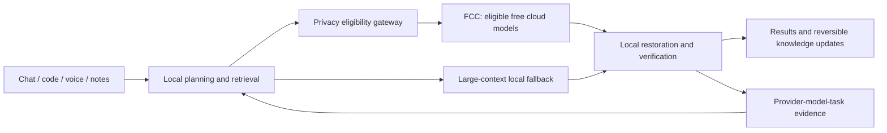

# UltiStack

**A personal AI platform designed to maximize verified free-cloud offloading while retaining large-context local capability.**

Status: design and documentation in progress. An earlier local build demonstrated chat, vision/tool calls, coding edits with tests, and file-based voice. The integrated UltiStack privacy, routing, knowledge, and verification pipeline is planned, not deployed.

## Design

- **Z13 first:** complete initial platform on a 128 GB unified-memory laptop; no large server dependency.
- **Offload progressively:** use [Free Claude Code](https://github.com/alishahryar1/free-claude-code) for eligible tasks and increase allocation using measured outcomes.
- **Keep privacy separate from accuracy:** Presidio, Piiranha, secret scanning, contextual anonymization, and policy checks are planned layers. None guarantees perfect redaction.
- **Maximum usable native contexts:** validate filled inputs, output allowance, memory peaks, quality, and responsiveness rather than quoting configured capacity.
- **Integrated notes:** source-linked retrieval, active Obsidian organization, action history, and undo.
- **Scale incrementally:** existing home-lab machines provide persistent services and monitoring; a larger inference server is a later iteration.

## Planned model roles

| Role | Candidate / baseline |
|---|---|
| Local multimodal orchestrator | mudler Qwen3.6-35B-A3B APEX-I-Quality + matching projector; exclusive heavy-model slot |
| Heavy local coding | mudler Qwen3-Coder-Next APEX-I-Quality; on demand, 262K context target |
| Code and notes indexing | Qwen3-Embedding-0.6B and 4B, separate Qdrant collections |
| Retrieval ranking | Qwen3-Reranker-0.6B |
| Document extraction | Dedicated OCR candidate, exact artifact pending validation |
| Anonymization / note assistance | Qwen3-4B-Instruct-2507; deterministic restoration in application code |
| Advisory screening / task classification | Guard and router candidates, pending artifact and capability validation |
| Voice | Compare Qwen3-ASR-0.6B / Qwen3-TTS 0.6B with Whisper / Kokoro; independently validated Linux NPU runtimes |
| Cloud execution | FCC-configured free-tier provider models |

Model names describe intended roles; artifact compatibility, licensing, context, quantization, and acceleration require validation. No throughput, instant-swap, or complete-privacy guarantee is claimed.

## Delivery plan

1. Linux migration with backup, hardware checks, and rollback.
2. Recover local chat/coding/voice baseline and validate maximum contexts.
3. Integrate home-lab backups, persistent services, and monitoring.
4. Add retrieval and reversible Obsidian changes.
5. Validate a synthetic privacy gateway and bounded FCC pilot.
6. Expand eligible offloading with independent tests and provider/task evidence.
7. Publish measured case studies; scale inference capacity when justified.

See [corrected stack](docs/stack.md), [voice/NPU reassessment](docs/voice-migration.md), [project status](docs/status.md) and [publication policy](docs/publication.md). Detailed engineering records are maintained in a separate private repository. This public repository has independent Git history and contains no personal vault, raw conversations, credentials, or operational databases.

Author: Michael Tolson. No software license has been selected yet.
